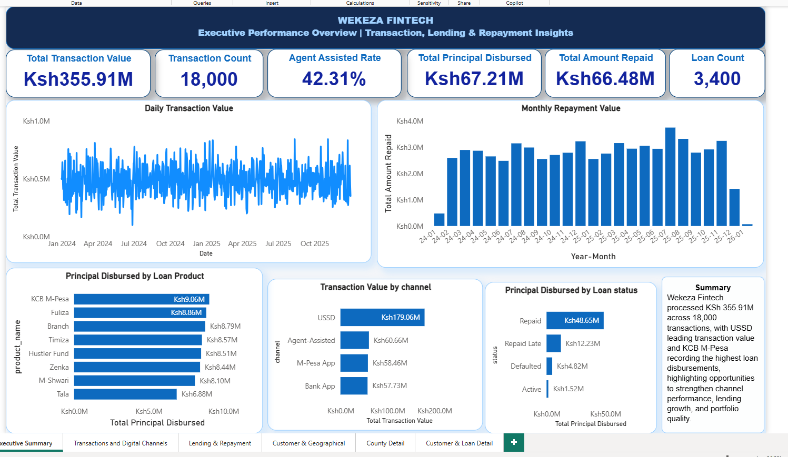
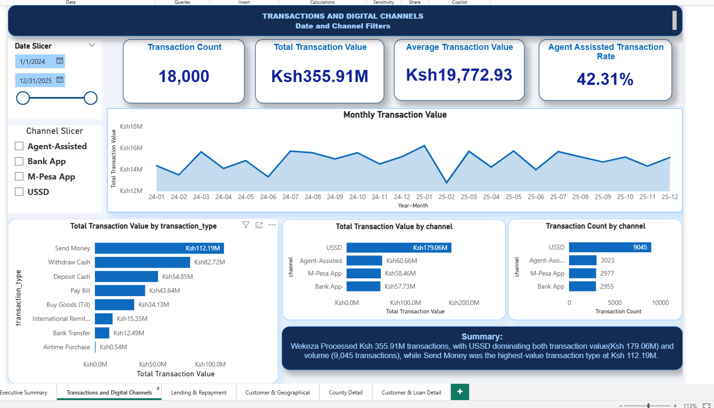
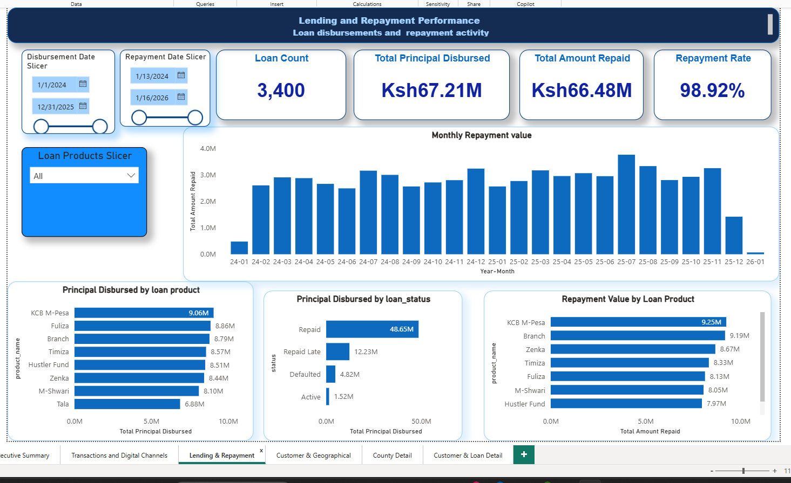
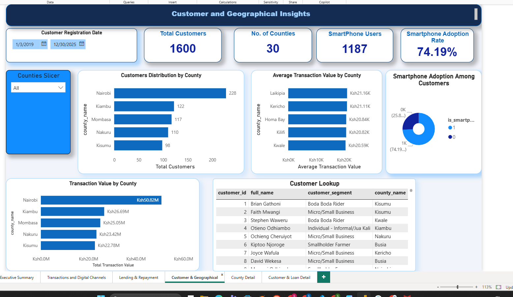
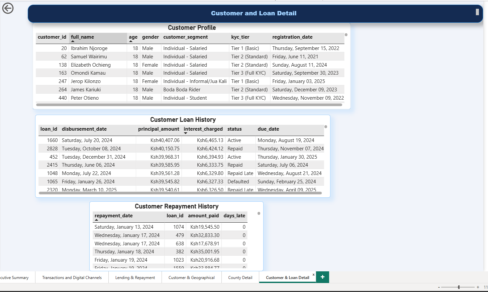

# Wekeza Fintech: Power BI Analysis

## About the project

I built this Power BI report to explore transaction activity, digital channels, customers, lending, and repayments using a synthetic Kenyan fintech dataset. My goal was to turn the raw relational data into a report that makes the main patterns easier to understand and investigate.

## Tools used

- SQLite for the source database
- Python and pandas to load the tables into Power BI
- Power Query for data cleaning and preparation
- Power BI for data modelling, DAX measures, visuals, and drill-through

## Data preparation and modelling

I imported seven tables from `kenya_fintech.db`: `transactions`, `customers`, `agents`, `counties`, `loans`, `repayments`, and `loan_products`.

During preparation, I checked data types, standardized date fields where needed, reviewed missing values and key columns, and created an `agent_involved` classification. I also created a date-only transaction column because timestamps were preventing the transaction dates from matching the calendar table correctly.

I set up relationships between customers, counties, transactions, loans, loan products, and repayments. I used separate date dimensions for transaction/disbursement dates, repayment dates, and customer registration dates. I organized the main DAX measures in a `Wekeza_Measures` table.

## Dashboard

### Executive Summary

### Transactions and Digital Channels

### Lending and Repayment

### Customer and Geographical Insights

### County Performance Detail

### Customer and Loan Detail

The report includes KPI cards, trend charts, channel and product comparisons, customer and county analysis, slicers, and drill-through pages for county and customer-level investigation.

## Key findings

- The dataset contains **1,600 customers**, **18,000 transactions**, and **3,400 loans** across **30 counties**.
- Total transaction value is **KSh 355.91M**, with an average transaction value of about **KSh 19,772.93**.
- USSD leads transaction value at **KSh 179.06M** and accounts for **9,045 transactions**.
- Send Money is the highest-value transaction type at approximately **KSh 112.19M**.
- Total principal disbursed is **KSh 67.21M**, while recorded repayments total **KSh 66.48M**.
- KCB M-Pesa has the highest principal disbursement among the displayed loan products, at approximately **KSh 9.06M**.
- **74.19%** of customers are marked as smartphone users.

## Business implications and recommendations

USSD is an important channel in this dataset, so I would monitor its reliability, fees, and operating costs alongside transaction value. Loan products should be compared using default and late-repayment measures as well as disbursement volume before making lending-growth decisions. County-level investment decisions should also consider population-normalized customer coverage and agent density, not transaction value alone.

## Limitations

The data is synthetic and is intended for portfolio demonstration; it does not represent real customers or financial institutions. The database covers 30 counties, not all 47 counties in Kenya. The current report is mainly descriptive and does not yet include every metric in the original brief, such as a validated Portfolio at Risk measure, population-normalized county penetration, or agent density. The displayed **98.92%** repayment comparison is total amount repaid divided by principal disbursed, so it should not be interpreted as a cohort-based repayment rate.

## Files

- `README.md` — project overview and findings
- `outputs/` — dashboard screenshots, date dax formula and data model
- `sqlite_powerbi_import.py` — Python script used to load the SQLite tables into pandas
- `Kenya_Fintech_BI_Project_Brief.pdf` — original project brief

> **Data notice:** Wekeza Analytics is fictional, and the database is synthetically generated for portfolio/demo purposes.
# Wekeza_Fintech_PowerBi_Analysis
